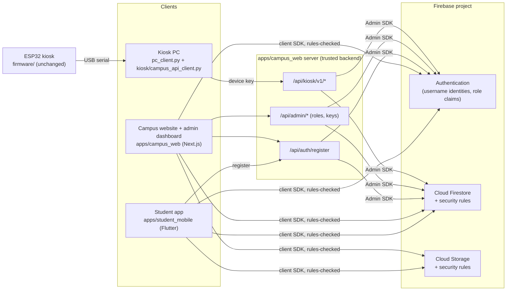

# Campus Mithra platform - architecture

One Firebase project behind four clients:



| Part | Where | Notes |
|---|---|---|
| Shared schema, rules, indexes, seed, admin scripts, rules tests | `firebase/` | `schema/constants.json` is the shared vocabulary |
| Website, admin dashboard, backend API | `apps/campus_web/` | Next.js 16, TypeScript, Tailwind 4 |
| Student app | `apps/student_mobile/` | Flutter 3.44 or newer (Dart 3.12+), Android/iOS (web build for tests) |
| Kiosk integration | `kiosk/` | contract, Python client |
| Existing kiosk | `firmware/`, `server/`, `pc_client.py`, `kb/`, `web/` | the ESP32 kiosk and its PC server |
| RFID attendance | `archive/rfid/`, `firmware/src/rfid_receiver.cpp`, `kiosk/rfid_bridge.py` | **turned off for now** (below) |
| OV7670 camera node | `archive/camera/` | **parked**, not used or integrated |

## Turned off for now

The platform in use is the kiosk, the website with its dashboard, and the
student app. Two pieces of earlier work are parked, with their code kept:

- **OV7670 camera node**: moved to `archive/camera/`. Nothing else uses it.
- **RFID attendance** (UNO Q card reader -> kiosk ESP32 -> kiosk PC -> website):
  every part is switched off, and the reader sketch and its host tests are in
  `archive/rfid/` (`bash archive/rfid/tests/run.sh` still passes). The
  Firestore rules and indexes for it stay deployed; with the routes off, nothing
  writes those collections.

### Turning RFID attendance back on

All four switches, then rebuild each part:

| Part | Switch |
|---|---|
| Kiosk ESP32 | `#define RFID_ENABLED 1` in `firmware/include/config.h` (or `-D RFID_ENABLED=1` in `platformio.ini`), then reflash |
| Kiosk PC | `RFID_ATTENDANCE=on` in `kiosk/.env`, next to `CAMPUS_API_URL` and `CAMPUS_KIOSK_KEY` |
| Website + dashboard + API | `NEXT_PUBLIC_FEATURE_RFID_ATTENDANCE=true` and `RFID_UID_HMAC_SECRET` in `apps/campus_web/.env.local`, then rebuild |
| Student app ("My attendance") | `--dart-define=FEATURE_RFID_ATTENDANCE=true` (or `FEATURE_RFID_ATTENDANCE=true` in `.env`) |

Tests with it on: `E2E_RFID=1 npm run e2e` (website) and
`SMOKE_RFID=1 bash tool/web_smoke.sh` (app). Setup and wiring:
docs/RFID_INTEGRATION.md.

## Decisions

- **Trusted backend = the Next.js server's API routes**, not Cloud Functions.
  The website needs a server anyway; one deployable keeps setup small, and the
  Admin SDK runs with Application Default Credentials. Moving a route to a
  Cloud Function later is mechanical (same code, same Admin SDK).
- **Most reads and writes go straight from the clients to Firestore**, and the
  security rules decide. Privileged operations (creating accounts, changing
  roles, device keys, RFID) go through the backend, which checks the caller's
  ID token and role.
- **Campus map = SVG/CustomPainter over a graph**, no map-tile provider or
  billing. One `campusMap/main` document holds walkway points and edges;
  Dijkstra runs on the device (`navigation.ts` / `navigation.dart`, tested on
  the same sample map).
- **Notifications are in-app** (Firestore `notifications`). Push via FCM is not
  set up: it needs a server-side sender (a Cloud Function or the backend) and
  per-device tokens; the `notifications` documents are already the right
  trigger for it.

## Username sign-in

Firebase Authentication has no username provider. The platform maps each
username to an internal sign-in identifier:

```
asha.k  ->  asha.k@users.campus-mithra.invalid
```

- `.invalid` is a top-level domain reserved by RFC 2606: nothing can ever be
  delivered there, so the identifier is never a real or guessable mailbox.
- Students only see and type the username. The apps derive the identifier
  (`identityFor()` in `username.ts` / `username.dart`) and call
  `signInWithEmailAndPassword`; Firebase Auth stores and checks the password.
  No code stores, hashes or logs a password.
- **Registration goes through the backend** (`POST /api/auth/register`):
  validate and normalise the username (lowercase, `^[a-z][a-z0-9._]{2,23}$`,
  no reserved names), reserve `usernames/<name>` in a transaction (unique),
  create the Auth user, set the custom claims `{role: "student", active: true}`,
  write `users/<uid>`. A failed Auth creation releases the reservation.
- `REGISTRATION_MODE`: `open`, `invite` (needs a campus code) or `closed`
  (administrators create accounts in Dashboard > Users).
- **Accounts created any other way** (for example straight against the Auth
  REST API with the public web key) have no claims, so the rules give them
  public read access only. Also switch off client sign-up in the Firebase
  console (docs/FIREBASE_SETUP.md).
- **Recovery**: no email, so no reset link. An administrator sets a temporary
  password (Dashboard > Users > Password); the student changes it under
  My account (re-authentication required). Sessions are revoked on reset.
- **Suspension** sets `active: false` in the claims, disables the Auth user and
  revokes refresh tokens.
- Limitation: usernames cannot be renamed (the identifier is derived from them).
- Verified with the Auth emulator; check once on your real project
  (docs/TESTING.md). If a project ever rejects the `.invalid` identifier, set
  `identityDomain` in `firebase/schema/constants.json` to a subdomain you own
  with no mail service (all clients read it) **before** creating accounts.

## Roles and authorization

| Role | Can |
|---|---|
| `student` | read public and member content; post, reply, vote, flag; file and follow own reports; edit own profile |
| `staff` | + read all reports; update reports assigned to them (status, notes); notify the reporter |
| `club_manager` | + create and edit events of the clubs whose `managerIds` include them; edit those clubs' description/contact |
| `admin` | everything above + directory, map, announcements, clubs, moderation, QR codes, kiosk, attendance; roles and accounts through the API |

Roles live in Auth custom claims (set only by the Admin SDK) and are mirrored
in `users/<uid>.role` for display. The dashboard hides what a role cannot use,
but **every write is checked by `firestore.rules` / `storage.rules` or by the
API route** (`requireCaller`). 23 rules tests and the end-to-end test prove a
student cannot perform admin operations by calling Firestore or the API
directly.

## Firestore schema

Every document has stable ids, `createdAt`/`updatedAt` (server timestamps, the
rules check `== request.time`), and ownership fields where relevant. Seed
content carries `isSample: true` and is labelled "Sample data" in every UI.

| Collection | Key fields | Read | Write |
|---|---|---|---|
| `users/{uid}` | username, displayName, role, status, department, year, bio, notificationsSeenAt, lastPostAt, lastCommentAt | owner, admin | backend; owner: profile fields only |
| `usernames/{username}` | uid | nobody (no enumeration) | backend |
| `buildings/{id}` | name, code, category, x/y/w/h, entranceNodeId, floors, openingHours, accessible, published | public if published | admin |
| `locations/{id}` | name, type, buildingId/Name, floor, room, navNodeId, keywords, openingHours, published | public if published | admin |
| `campusMap/main` | width, height, metersPerUnit, nodes[{id,x,y,label,landmark,buildingId}], edges[{id,from,to,accessible,note}] | public | admin |
| `announcements/{id}` | title, body, category (announcement/notice), status (draft/published/archived), pinned, publishedAt | public if published | admin |
| `campusKnowledge/{id}` | title, body, sourceType, status, access, createdBy/At, updatedAt, publishedAt, isSample | public if published and access is `public`; admin | admin |
| `clubs/{id}` | name, category, description, contact, homeLocationId, managerIds[], published | public if published; its managers | admin; managers: description/contact |
| `events/{id}` | clubId/Name, title, description, startAt, endAt, venueName, venueLocationId, status (draft/published/cancelled), createdBy | public if published/cancelled; admin; the club's managers | admin; the club's managers |
| `reports/{id}` | reporterId/Username, category, title, description, building/location, imagePath, status, assigneeId/Name, lastUpdateId/Message | reporter, staff | reporter creates (status `submitted`); admin; assigned staff |
| `reports/{id}/updates/{id}` | type (status/assignment/comment), fromStatus, toStatus, message, byId/Name, at | reporter, staff | in the same batch as the report change; reporter comments; immutable |
| `settings/reportWorkflow` | transitions {from: [to]} | signed in | admin |
| `posts/{id}` | author*, title, body, category, locationId/Name, status (visible/hidden/removed/deleted), public, helpfulCount, commentCount, lastActivityAt | members when visible; anyone when `public`; author; admin | members (rate-limited); author edits/deletes; admin moderates and approves for the website |
| `posts/{id}/comments/{id}` | author*, body, status | as the post | members (rate-limited, counted on the post) |
| `posts/{id}/reactions/{uid}` | createdAt | members | one per member, counted exactly |
| `flags/{type}_{target}_{uid}` | reporterId, targetType, targetPath, reason, status | admin | members create (once per target); admin resolves |
| `notifications/{id}` | type, audience (user/all), userId, title, body, link, read, reportId | the user; members for `all` | staff for a reporter's report; admin broadcasts; the user marks read |
| `qrDestinations/{type-target}` | type, targetId, label, path, active | public if active | admin |
| `kioskConfig/{id}` | name, locationId, navNodeId, welcomeText, enabledActions, announcementsLimit, featuredLocationIds | public | admin |
| `kioskDevices/{id}` | name, keyHash, keyPrefix, capabilities, active, lastSeenAt | nobody | backend |
| `settings/attendance`, `attendanceSessions`, `attendanceRecords`, `rfidCards`, `attendanceAudit` | see docs/RFID_BACKEND.md | admin; a student reads own `attendanceRecords` | admin (settings, sessions); backend (the rest) |

### Validation and abuse controls (in the rules)

- Field types, enumerations and lengths are checked on create/update; posts,
  reports and comments are limited to their known keys (`hasOnly`).
- Authors are bound to the signed-in user (`authorId == uid`,
  `authorUsername == users/<uid>.username`): no impersonation.
- Rate limits: a post needs `users/<uid>.lastPostAt` set to `request.time` in
  the same batch and older than 30 s (replies: 10 s).
- Counters can only move by exactly one, together with the document that
  justifies it (a reaction or a comment), so they cannot be inflated.
- Report status changes must follow the workflow table (default lifecycle
  Submitted -> Acknowledged -> Assigned -> In progress -> Resolved, plus
  Rejected; admins can edit the table) and must add a history entry in the
  same batch.
- Report photos: images only, 5 MB, under `reports/<uid>/<reportId>/`;
  readable by the reporter and staff only.
- Official content (announcements, events) and student opinions are separate
  collections with separate labels ("Official" / "Student opinion").

### Pagination and indexes

Lists load in pages (`limit` + `startAfter` cursors): events, notices, posts,
reports, users. Composite indexes are in `firebase/firestore.indexes.json`
(deploy with `npm run deploy:rules` in `firebase/`). A missing index shows a
clear message rather than failing silently.

## Kiosk

See `kiosk/README.md` and `kiosk/API_CONTRACT.md`. The ESP32 holds no
credentials; the kiosk PC holds one revocable, read-only device key.

## What is deliberately not here

- OV7670 camera integration (out of scope for this phase).
- Physical RFID verification: the reader chain is implemented but not yet run on the hardware (docs/RFID_TESTING.md).
- Push notifications (in-app only).
